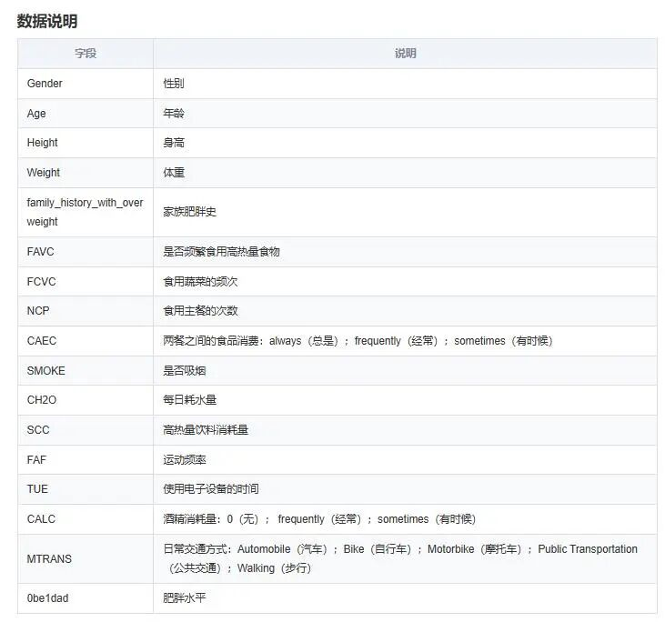

# Obesity Risk Dataset

Obesity risk is a topic of great concern. The causes of obesity are complex and diverse, involving both individual lifestyle factors and environmental and social constraints.

Obesity risk is a topic of great concern. The causes of obesity are complex and diverse, influenced by both individual lifestyle choices and environmental and societal factors. Individual dietary habits and exercise routines play a significant role in determining their risk of obesity. In today's society, the availability of high-calorie, high-fat, and high-sugar convenience foods has grown increasingly abundant, coupled with the fast pace of modern life, making unhealthy eating and lack of physical activity the norm. Additionally, psychological factors cannot be overlooked; issues such as stress, anxiety, and depression can lead to uncontrollable appetite, thereby increasing the risk of obesity. Overall, the complexity of obesity risk far exceeds individual choice and willpower, necessitating a thorough exploration of its root causes and seeking comprehensive solutions.

## Payment

Here is a pay link on Stripe ( https://buy.stripe.com/3cs8yP7sY87d0vu9AB ). Please contact me lonlonago@foxmail.com after funding $89, and I will send you a complete data files , thank you!

